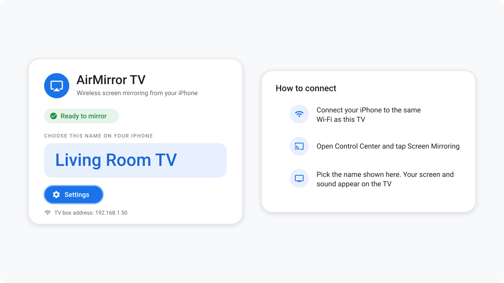
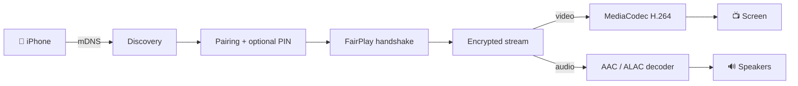

<div align="center">


**Mirror your iPhone, iPad or Mac to any Android TV or TV box.**<br>
Screen and sound over AirPlay. Nothing to install on the Apple device.


### ⬇️ Download

| Your TV runs | Get this APK |
|:---:|:---:|
| **Android 8.0 or newer** | [**AirMirrorTV-android8.apk**](AirMirrorTV-android8.apk) · 2.1 MB |
| **Android 5.0 – 7.1** (older boxes) | [**AirMirrorTV-android5.apk**](AirMirrorTV-android5.apk) · 2.4 MB |

<sub>Not sure? The android5 APK also works on newer Android. Find your version in the TV's Settings → About.</sub>

<br>



<sub>The home screen, drawn from the app's design.</sub>

</div>

---

## ✨ Features

<table>
<tr>
<td width="50%" valign="top">

**🖥️ Full-screen mirroring**<br>
Hardware H.264 decoding, letterboxed to the right shape. Rotate the picture with ◀ ▶ on the remote.

</td>
<td width="50%" valign="top">

**🔊 Sound included**<br>
AAC-ELD, AAC-LC and ALAC audio. ALAC is decoded in software, so it works even on boxes without an ALAC decoder.

</td>
</tr>
<tr>
<td valign="top">

**🎬 Video casting**<br>
The AirPlay button inside YouTube, Safari and other apps plays the video directly on the TV.

</td>
<td valign="top">

**🔒 Who can connect**<br>
Ask Allow/Deny on the TV, require a PIN on the iPhone, or let anyone connect.

</td>
</tr>
<tr>
<td valign="top">

**📡 Always listening**<br>
Keeps running in the background after you close it, and comes to the front when a phone connects.

</td>
<td valign="top">

**🕰️ Old boxes welcome**<br>
Runs on Android 5.0 Lollipop and newer, with no Google services needed.

</td>
</tr>
</table>

## 🚀 Quick start

1. **Install** the APK for your TV (see **Download** above and **Installing** below).
2. Put the TV and the iPhone on the **same Wi‑Fi network**.
3. Open **AirMirror TV** on the TV. It shows the receiver name, for example *Living Room TV*.
4. On the iPhone: **Control Center → Screen Mirroring →** pick that name.
5. To stop, tap **Stop Mirroring** on the iPhone.

## 📦 Installing

**With a USB stick:** copy the APK to the stick, open it with the TV's file manager and allow *Install unknown apps* when asked.

**With adb:**

```bash
adb connect <tv-ip-address>
adb install -r AirMirrorTV-android8.apk
```

Use `AirMirrorTV-android5.apk` instead on Android 5–7.

## 🔒 Who can connect

Open **Settings** on the home screen (it's the first button the remote lands on), then pick one:

| Option | What happens |
|---|---|
| ✅ **Ask on the TV** *(default)* | A new device shows an **Allow / Deny** prompt on the TV. Allowed devices are remembered. |
| 🔢 **Require a PIN on the iPhone** | You choose a **4–8 digit PIN**. The iPhone shows an *AirPlay password* box and must type it before mirroring or audio starts. It can remember it. After 5 wrong tries the connection is dropped. |
| 🔓 **Anyone can connect** | No prompt. Every device on the network connects automatically. |

> [!NOTE]
> In PIN mode, video casting from an app's own AirPlay button (YouTube and similar) still shows **Allow / Deny** on the TV, because iOS doesn't ask for the AirPlay password for casting.

You can also **rename the receiver** in Settings. That's the name iPhones show in Screen Mirroring.

## 🎮 Remote control

| Button | Does |
|---|---|
| **OK** on Settings | Opens Settings (rename, who can connect, PIN) |
| **◀ ▶** while mirroring | Rotates the picture 90° |
| **Back** | Leaves the app. The receiver keeps listening in the background. |

## 🛟 Troubleshooting

<details>
<summary><b>The TV isn't in the iPhone's Screen Mirroring list</b></summary>

- Check that both are on the **same Wi‑Fi** (not a guest network).
- Turn off *client isolation* / *AP isolation* on the router.
- Open AirMirror TV once after the TV restarts, so the receiver starts.
</details>

<details>
<summary><b>It's stuck on "connecting", or the iPhone keeps asking for a password</b></summary>

- If you changed the PIN, the iPhone may still have the old one saved. Type the new PIN when asked.
- Close the app on the TV, open it again, then mirror again.
</details>

<details>
<summary><b>Black screen or no sound</b></summary>

Stop mirroring, reopen the app and mirror again. If it keeps happening, open an issue and attach the output of `adb logcat`.
</details>

## 🧩 How it works



| Module | Role |
|---|---|
| [`airplay/`](airplay) | AirPlay receiver: mDNS, pairing, FairPlay, RTSP/HTTP control, HLS casting. Based on [serezhka/java-airplay](https://github.com/serezhka/java-airplay), patched for Android 5 and rewritten in Kotlin. |
| [`app/`](app) | The Android TV app: Material UI, background service, hardware video and audio decoding. |

## 🛠️ Building

Written in **Kotlin**. You need JDK 17, the Android SDK (platform 34) and Gradle 8.7.

```bash
gradle assembleRelease
```

This builds both APKs:

| Variant | Output | Minimum Android |
|---|---|---|
| `android8` | `app/build/outputs/apk/android8/release/` | 8.0 (API 26) |
| `android5` | `app/build/outputs/apk/android5/release/` | 5.0 (API 21) |

Run the tests with `gradle :airplay:test`.

## ⚠️ Limits

- After the TV restarts, open the app once to start the receiver.
- It's a screen-mirroring and casting receiver. AirPlay 2 multi-room audio isn't supported.

## 📄 License

Copyright © 2026 mbnetworku. Released under the [MIT License](LICENSE).<br>
The `airplay/` module is derived from serezhka/java-airplay (MIT); its notice is in [`airplay/LICENSE-java-airplay`](airplay/LICENSE-java-airplay).<br>
Icons are [Google Material Icons](https://fonts.google.com/icons) (Apache License 2.0).
